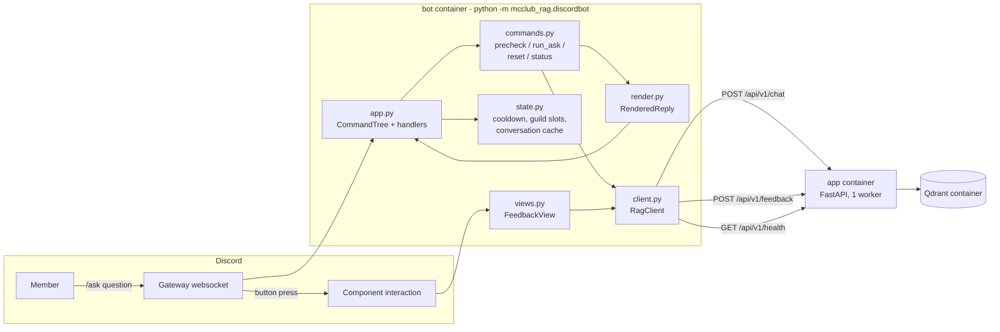

# Design Document

## Decisions needing your confirmation

Three points the requirements leave open, each with the default this design implements:

1. **Command surface — three slash commands, not one.** `/ask`, `/reset`, `/status`. Requirement 1.1's
   "exactly one slash command" is the wording that changes: only `/ask` reaches the chat API, while
   requirements 4.4 and 6.4 already require `/reset` and `/status`. Registered as guild commands when
   `DISCORD_GUILD_ID` is set, globally otherwise.
2. **Expired interaction — never publish a private answer.** A `public: true` answer is posted to the
   channel as designed; an ephemeral answer that can no longer be delivered is replaced by a short
   "please ask again" notice and the answer is dropped (and logged). Requirement 7.3's follow-up
   message therefore applies to public answers only. Publishing an ephemeral answer into a channel
   would leak exactly what the user asked to keep private.
3. **Guild scope — the member role is honoured in the configured guild only.** `DISCORD_MEMBER_ROLE_ID`
   grants members-level access when `interaction.guild_id == DISCORD_GUILD_ID`; every other guild and
   every DM is public-only, which is also the behaviour when either variable is unset. The
   conversation cache key stays namespaced per guild (requirement 4.3) because it is a local cache key
   and costs nothing, but it carries no access meaning.

## Overview

The bot is a thin, asynchronous client over the API that already exists. It owns no retrieval, no
generation, no document store and no model file: it translates a Discord interaction into one
`POST /api/v1/chat`, renders what comes back, and turns two buttons into one
`POST /api/v1/feedback`. Every fact this design relies on was read from the code, not assumed:

| Contract | Source | Verified shape |
| --- | --- | --- |
| Chat request | `schemas.py`, `api/chat.py` | `message` (max 2000), optional `conversation_id` |
| Chat response | `schemas.py` | `answer`, `conversation_id`, `grounded`, `sources[{doc_id,title,snippet}]`, `usage{llm_calls,prompt_tokens,completion_tokens}`, `latency_ms` |
| Auth | `deps.py` | no `Authorization` -> `public`; `Bearer <MEMBER_TOKEN>` -> `member`; wrong token -> 401 |
| Errors | `errors.py` | always `{"error":{"code","message"}}` |
| Rate limit | `rate_limit.py`, `api/chat.py` | per client IP, 20/60 s by default, 429 `rate_limited`, **no `Retry-After`** |
| Conversations | `conversation.py`, `api/chat.py` | in-memory, 30 min TTL, 3 turns, ids minted as `c_<uuid4>` |
| Feedback | `api/feedback.py`, `schemas.py` | unauthenticated, `{conversation_id, rating: up\|down, comment?}`, returns `{"ok": true}` |
| Health | `api/health.py` | `{status: ok\|degraded, documents: int}` — **no LLM headroom field** |
| App settings | `config.py` | `extra="ignore"`, so the app ignores every `DISCORD_*` variable |

The property that makes the whole design work: `api/chat.py` loads the conversation by the id it is
given and, when that id is unknown, mints a fresh one and returns **that** in the response. An
unknown id is therefore not an error and not a continuity break — it is a first turn.

## Architecture



The bot dials out to Discord's gateway, so it needs no inbound port, no public URL, no TLS and no
reverse proxy (requirement 9.2). It talks to the app over the Compose network at
`http://app:8000`, the same DNS name `docker-compose.yml` already gives the service.

**Deployment (requirement 9.1).** A third Compose service reusing the app image:

- `bot`: `restart: unless-stopped`, `env_file: .env`, `depends_on: app: {condition: service_healthy}`
  so it waits for the app's existing healthcheck.
- `command: python -m mcclub_rag.discordbot` replaces the image's `uvicorn` CMD.
- `healthcheck: {disable: true}` because the image's healthcheck curls `localhost:8000`, which the
  bot does not serve; without this the container would report unhealthy forever.
- no `ports`, no `volumes`, no `qdrant` dependency.

`discord.py~=2.7` goes in `[project] dependencies` so the single `uv.lock` stays authoritative and the
bot needs no second install step (requirement 9.3). The cost is that the API image also carries
discord.py; the alternative — a separate `bot/Dockerfile` and a `bot` dependency group — is
physically cleaner but adds a second build to keep green, and this design takes the simpler one.

## Components and Interfaces

New subpackage `src/mcclub_rag/discordbot/`. It is a subpackage of the installed distribution, so tests
import it with no packaging change and `python -m mcclub_rag.discordbot` resolves in the container. It
imports **nothing** from `ingest/`, `retrieval/` or `llm/`, so no model file, no ONNX runtime and no
xberg is pulled in (requirement 9.4). Two exceptions, both light and verified: `logging.configure_logging`
(structlog only) and `text.lang.detect_language` for notice language — `ingest/__init__.py` is empty,
so that import does not drag the parsing stack, and py3langid ships its own model with no download.

```
src/mcclub_rag/discordbot/
├── __init__.py
├── __main__.py    # entry point: configure_logging, build settings, run the client
├── settings.py    # BotSettings (DISCORD_* + MEMBER_TOKEN + LOG_LEVEL)
├── client.py      # RagClient: the only place httpx and the URL live
├── commands.py    # pure logic: precheck, run_ask, run_reset, run_status
├── render.py      # ChatResponse -> RenderedReply (splitting, grounding, sources)
├── notices.py     # localized bot-side strings + notice_language
├── state.py       # ConversationDirectory, UserCooldown, GuildSlots
├── views.py       # FeedbackView and the /ask answer's buttons
└── app.py         # discord.py wiring: CommandTree, defer/edit/followup, role check
```

### `settings.py` — `BotSettings`

```python
class BotSettings(BaseSettings):
    model_config = SettingsConfigDict(env_prefix="DISCORD_", env_file=".env", extra="ignore")
    bot_token: str  # DISCORD_BOT_TOKEN, min_length=1
    rag_base_url: str = "http://app:8000"  # DISCORD_RAG_BASE_URL
    guild_id: int | None = None  # DISCORD_GUILD_ID
    member_role_id: int | None = None  # DISCORD_MEMBER_ROLE_ID
    user_cooldown_s: float = Field(default=20.0, ge=0)  # DISCORD_USER_COOLDOWN_S
    max_concurrency: int = Field(default=4, gt=0)  # DISCORD_MAX_CONCURRENCY
    api_timeout_s: float = Field(default=60.0, gt=0)  # DISCORD_API_TIMEOUT_S
    member_token: str | None = Field(default=None, validation_alias="MEMBER_TOKEN")
    log_level: str = Field(default="INFO", validation_alias="LOG_LEVEL")
```

`validation_alias` bypasses the `DISCORD_` prefix for the two variables the bot shares with the app,
whose names `.env` already fixes. `extra="ignore"` lets the bot read the same `.env` the app reads
without choking on the other forty settings. `bot_token` is required and non-empty, so an unfilled
`DISCORD_BOT_TOKEN=` fails at startup with a clear message rather than at the first gateway login —
the same fail-fast posture as `verify_tessdata()`.

A `model_validator(mode="before")` drops blank values before validation, so a `DISCORD_X=` line means
"unset" and the field keeps its default. This is not a nicety: `.env.example` ships
`DISCORD_GUILD_ID=` and `DISCORD_MEMBER_ROLE_ID=` blank to mean "register globally" and "every
question public", a present-but-empty variable is not an absent one for pydantic-settings, and
without the drop the shipped defaults were a startup `ValidationError` — observed on the real `.env`
on 2026-10-16, before any gateway connection. `bot_token` is the one field the validator must not
drop: that is what keeps Req 8.2's deliberate failure intact. The Compose path reaches the same code
with the same empty string (an `env_file` line is passed through, not omitted); that leg is reasoned
from `env_file` semantics, not exercised — the Docker daemon was down for this run.

```python
@model_validator(mode="before")
@classmethod
def _blank_means_unset(cls, data: Any) -> Any:  # an empty DISCORD_X= is not a value
    ...
```

### `client.py` — `RagClient`

```python
class RagClient:
    def __init__(
        self,
        base_url: str,
        *,
        timeout_s: float,
        member_token: str | None,
        transport: httpx.AsyncBaseTransport | None = None,
    ) -> None: ...
    async def aclose(self) -> None: ...
    async def ask(
        self, question: str, *, as_member: bool, conversation_id: str | None = None
    ) -> ChatOutcome: ...
    async def feedback(self, conversation_id: str, rating: Literal["up", "down"]) -> bool: ...
    async def health(self) -> HealthOutcome: ...
```

- One `httpx.AsyncClient` for the process lifetime, `timeout=settings.api_timeout_s`, reusing the
  `httpx~=0.28` already in `dependencies`.
- `Authorization: Bearer <member_token>` is sent **only** when `as_member` is true and a token is
  configured; otherwise the header is absent, which `deps.py` reads as `public` (requirement 3.1).
- `conversation_id` is included in the body only when it is not `None`, so a first turn omits the key
  entirely.
- Non-2xx parses `error.code` out of the guaranteed envelope; transport failures become
  `unreachable` / `timeout`. Nothing above this class sees an `httpx` exception, and nothing below it
  sees a Discord type (requirement 7.1).
- `transport` is injectable so the whole class is testable with `httpx.MockTransport`.
- The token and the question text never reach a log call; only the failure code and `latency_ms` do
  (requirements 3.1, 7.5).

### `commands.py` — pure decision logic

```python
@dataclass(frozen=True)
class AskRequest:
    question: str
    public: bool
    user_id: int
    asker: str  # display name, for the attribution line
    guild_id: int | None
    channel_id: int
    as_member: bool


def precheck(
    request: AskRequest, *, cooldown: UserCooldown, slots: GuildSlots
) -> Notice | None: ...  # synchronous, no await


async def run_ask(
    request: AskRequest, *, client: RagClient, conversations: ConversationDirectory
) -> RenderedReply: ...


def run_reset(
    guild_id: int | None, channel_id: int, conversations: ConversationDirectory
) -> RenderedReply: ...


async def run_status(*, client: RagClient, settings: BotSettings) -> RenderedReply: ...
```

`precheck` answers the two cases that must not reach the network — a question over 2000 characters
(requirement 1.4) and a caller still inside their cooldown or a guild already at its concurrency cap
(requirement 6.1) — and is synchronous so `app.py` can refuse *before* deferring, wasting no
interaction and no API call. A blank or whitespace-only question passes through untouched, because
the API answers it with a prompt and `grounded: false` (requirement 1.5).

`run_ask` resolves the conversation id, makes the single call and renders. It never retries and never
issues a second call (requirement 6.3).

### `render.py` — `RenderedReply`

```python
@dataclass(frozen=True)
class FieldSpec:
    name: str
    value: str


@dataclass(frozen=True)
class EmbedSpec:
    description: str
    fields: tuple[FieldSpec, ...] = ()
    footer: str | None = None
    colour: int = 0x2ECC71  # green when grounded, grey when not


@dataclass(frozen=True)
class Message:
    content: str
    embed: EmbedSpec | None
    ephemeral: bool


@dataclass(frozen=True)
class RenderedReply:
    parts: tuple[Message, ...]  # parts[0] edits the deferred response
    feedback: str | None = None  # conversation id for the buttons
```

`RenderedReply` is deliberately made of plain dataclasses. Everything the requirements pin down about
what a member sees is therefore testable without a Discord connection: the command layer produces a
`RenderedReply`, and `app.py` does nothing but send it.

Rendering rules:

- Part 0 carries the answer in an embed description, capped at 4000 characters; grounding label
  (requirement 2.2), sources as fields (`title` + `snippet`, truncated at 1024, **never** `doc_id` —
  requirements 2.1, 2.6) and a footer with `llm_calls` / prompt / completion tokens.
- An answer longer than the embed leaves continues as content-only messages split at paragraph, then
  word, boundaries at 1900 characters, in order, with nothing dropped; every part that is followed by
  another ends with `…` and multi-part answers carry a `(n/m)` footer (requirement 2.4).
- Text is passed through unchanged — no transliteration, no rewriting, no whitespace reflow that could
  reorder Arabic (requirement 2.3).
- When `public`, part 0's content is the attribution line naming the asker; mentions are suppressed
  with `discord.AllowedMentions.none()` so the line cannot ping anyone (requirement 2.5).
- `ephemeral` is `not public` on every part, including follow-ups.

### `state.py` — the three in-memory guards

```python
class ConversationDirectory:
    def get(self, guild_id: int | None, channel_id: int) -> str | None: ...
    def remember(self, guild_id: int | None, channel_id: int, conversation_id: str) -> None: ...
    def forget(self, guild_id: int | None, channel_id: int) -> None: ...


class UserCooldown:
    def __init__(self, seconds: float, *, clock: Callable[[], float] = monotonic) -> None: ...
    def acquire(self, user_id: int) -> float: ...  # 0.0 when allowed, else seconds remaining


class GuildSlots:
    def __init__(self, max_concurrency: int) -> None: ...
    def acquire(self, guild_id: int | None) -> bool: ...  # False when the guild is at its cap
    def release(self, guild_id: int | None) -> None: ...
```

**The conversation id is echoed, not chosen.** Requirement 4.1/4.3 as written has the bot *pass* its
own derived id, and that does not work: `ConversationStore.load()` returns `None` for an id it has
never seen and `api/chat.py` then calls `create()`, which mints `c_<uuid4>`. A bot that kept sending
`mc-<guild>-<channel>` would get a fresh conversation every single turn and never have history. So:

- `run_ask` omits `conversation_id` on the first turn in a channel and remembers the `conversation_id`
  the API **returned**, keyed by `(guild_id, channel_id)`.
- Every later turn sends that remembered id.
- If the API has forgotten it (30 min TTL, or a restart), the response carries a new id and the bot
  simply overwrites its entry. A TTL reset therefore looks like a first-turn answer and is
  indistinguishable, in code, from normal operation — which is exactly what requirement 4.2 asks for.
- `/reset` calls `forget()`; the abandoned conversation expires in the API on its own (requirement 4.4).

The namespaced `mc-<guild>-<channel>` key from requirement 4.3 survives as the **cache key**, which is
where it still does useful work (two guilds cannot collide), while the id on the wire is the API's.

The directory is a plain dict with no TTL: a stale entry is harmless because an unknown id is a valid
first turn, so expiry needs no bookkeeping. Losing the whole dict on restart costs, at most, one lost
follow-up per channel.

### `app.py` — the only discord.py-aware module

- One `discord.Client` with the default intents and a `CommandTree`; **no** `message_content`, no
  `on_message` handler, so no privileged intent and no Discord verification (requirement 1.2).
- `is_member(interaction)`: true only when the interaction is in `settings.guild_id`, the user is a
  `discord.Member`, and one of its roles is `settings.member_role_id` (requirements 3.1, 3.2).
  DMs and other guilds are public.
- The `/ask` handler, in order: `is_member` -> `precheck` -> refuse without deferring if it returns a
  notice -> `await interaction.response.defer(ephemeral=not public)` (requirement 1.3) -> `run_ask` ->
  `edit_original_response` for part 0, `followup.send` for the rest -> attach `FeedbackView` to the
  last part. The defer happens before any network call, well inside Discord's 3-second window;
  requirement 1.3 records the chat route's p95 as above that window, which is why the defer is
  mandatory rather than an optimisation.
- Each interaction gets its own `run_ask` coroutine and its own edits, so concurrent channels are
  independent (requirement 1.6).
- `GuildSlots` is released in a `finally`, so a failed call cannot leak a slot.
- Registry: `tree.sync(guild=...)` for the configured guild, `tree.sync()` otherwise; sync runs once at
  startup, not on every reconnect. The guild path must call `tree.copy_global_to(guild=...)` first:
  `@tree.command` registers into the tree's *global* mapping, and discord.py's `_get_all_commands`
  returns only the commands registered *for that guild*, so without the copy the PUT carries an empty
  list and Discord answers 200 while the guild sees nothing (found live on 2026-10-16).

### `views.py` — feedback buttons

```python
class FeedbackView(discord.ui.View):
    def __init__(self, conversation_id: str) -> None: ...
```

Two buttons whose `custom_id` encodes the conversation id and the rating, e.g.
`mcclub:fb:up:c_1e4f…`, which stays inside Discord's 100-character `custom_id` limit. On a press: call
`client.feedback`, then `interaction.response.edit_message(view=…)` with the pressed button disabled
and the other removed, plus an ephemeral confirmation (requirement 5.2). The rating is recorded once:
the view is replaced, so a second press cannot be counted. A failed feedback call is logged and never
touches the answer already delivered (requirement 5.3) — the press still gets its confirmation, or a
"could not record that" note if `ok` is false.

**Corrected while implementing.** An earlier draft of this section claimed `add_view` persistence
would let the buttons survive a restart. It cannot: discord.py re-dispatches a press only to a view
registered under the exact `custom_id`, and the conversation id inside ours makes that set unbounded,
so it cannot be pre-registered. Buttons sent before a restart therefore stop working after it, and
such a press records nothing. Requirements 5.1-5.3 say nothing about restarts, so this is a
documented limitation rather than a gap — the code states it next to the implementation.

## Data Models

Nothing is persisted by the bot; it writes no files, holds no database and owns no volume. The API
keeps writing `DATA_DIR/feedback.jsonl` exactly as it does today.

| Type | Fields | Lifetime |
| --- | --- | --- |
| `BotSettings` | the nine variables above | process |
| `AskRequest` | question, public, user_id, asker, guild_id, channel_id, as_member | one interaction |
| `ChatOutcome` | `response: ChatResponse` or `failure: ApiFailure` | one call |
| `ApiFailure` | `code` (`rate_limited`, `unauthorized`, `index_unavailable`, `validation_error`, `unreachable`, `timeout`, `internal`), `status: int \| None` | one call |
| `RenderedReply` | `parts: tuple[Message, ...]`, `feedback: str \| None` | one interaction |
| `Message` | content, `EmbedSpec \| None`, ephemeral | one send |
| `EmbedSpec` | description, fields, footer, colour | one send |
| `Notice` | `text`, `ephemeral: bool = True` | one refusal |
| conversation cache | `(guild_id, channel_id) -> conversation_id` | process, disposable |
| cooldown map | `user_id -> last monotonic timestamp` | process, disposable |
| guild slots | `guild_id -> in-flight count` | process |

The API-side types are reused, not redefined: `ChatResponse` and `Source` are imported from
`mcclub_rag.schemas` and parsed with pydantic, so a contract change breaks loudly at the boundary
rather than silently at render time.

## Error Handling

Every failure resolves to one ephemeral message, in the language of the question, and one log event.
`notice_language()` runs `detect_language` on the question and falls back to English, so a 429 or a
503 reaches the member in the language they asked in (requirement 7.2).

**Corrected while implementing.** The draft said the wording for "no answer" and "cannot answer right
now" would be reused from `mcclub_rag/messages.py`. It is not: those strings belong to the API's own
reply paths, and `UNAVAILABLE` points at "the sources" at a moment when the bot has none, so the bot
writes its own notices in `discordbot/notices.py`. Nothing a member normally reads is restated — only
the failure modes with no API reply at all live there.

| Condition | Detected by | Member sees | Logged | Retried? |
| --- | --- | --- | --- | --- |
| Question > 2000 chars | `precheck`, before defer | localized "too long" notice | `bot_ask_rejected`, reason | no |
| Cooldown / guild at cap | `precheck`, before defer | remaining seconds / "busy" | `bot_ask_rejected`, reason | no |
| `401 unauthorized` | `client.ask` -> `ApiFailure("unauthorized")` | "ask an admin for access" | `bot_ask_failed`, code | never (requirement 3.3) |
| `429 rate_limited` | error envelope | "the bot is busy, try again shortly" | `bot_ask_failed`, code | **no** — a retry loop would deepen the limit (requirement 6.2) |
| `503 index_unavailable` | error envelope | localized service notice | `bot_ask_failed`, code | no |
| `422 validation_error` | error envelope | generic notice | `bot_ask_failed`, code | no — a precheck bug, worth seeing in logs |
| connect / timeout | `httpx` exceptions | "the service is not answering" | `bot_ask_failed`, code | no |
| `5xx` / unparsable body | status + `internal` | generic notice | `bot_ask_failed`, status | no |
| Interaction expired mid-call | `discord.NotFound` on edit | see decision 2 | `bot_reply_undelivered` | no |
| Feedback call fails | `client.feedback` false | an ephemeral acknowledgement (Discord needs a response); the delivered answer is untouched | `bot_feedback_failed`, rating | no (requirement 5.3) |
| Discord API error elsewhere | `discord.HTTPException` | nothing | `bot_discord_error` | no (requirement 7.4) |

No failure path shows a raw JSON body or a traceback, and no path raises out of the event loop
(requirements 7.1, 7.4). One `bot_ask_done` event per interaction carries the ids, the latency, the
outcome, `grounded` and the usage numbers — and never the question text, the answer text or the token
(requirement 7.5).

## Testing Strategy

All of it runs with no Discord connection, no API and no model files, in the existing fast CI job
(`-m "not ocr and not tokenizer and not embedder and not reranker"`); no new marker is introduced and
`eval/e2e/` is untouched, so the bot is never scored by the harness (requirement 10.3).

The layering above exists to make this possible: `commands.py` and `render.py` are pure, and only
`app.py` and `views.py` touch discord.py.

| Test file | Covers |
| --- | --- |
| `tests/bot_fakes.py` | `FakeInteraction` / `FakeResponse` / `FakeFollowup` / `FakeChannel`, a recording `FakeRagClient`, and a real `discord.NotFound` for the expired path. Shared helper, mirroring `tests/pipeline_helpers.py`. |
| `tests/test_bot_settings.py` | `DISCORD_` prefix, the `MEMBER_TOKEN` / `LOG_LEVEL` aliases, an empty token failing fast, `extra="ignore"` with a full app `.env` (Req 8.1, 8.2) |
| `tests/test_bot_state.py` | the conversation directory round-trip, guild and DM separation with the namespaced key, the cooldown window on an injected clock, the guild cap and its release, and every notice table carrying ar/fr/en (Req 4.1, 4.3, 4.4, 6.1, 7.2) |
| `tests/test_bot_client.py` | `httpx.MockTransport`: Bearer header only for members, `conversation_id` omitted on the first turn, response parsing, and the `401`/`422`/`429`/`503`/`500`/connect/timeout -> `ApiFailure` mapping (Req 3.1, 6.2, 7.1) |
| `tests/test_bot_render.py` | embed shape, grounding label, sources by title with `doc_id` absent, answer splitting past the limits in order with nothing dropped, per-part `…`, usage footer, RTL text passed through byte-for-byte (Req 2.1-2.6) |
| `tests/test_bot_commands.py` | over-long and blank questions, cooldown and guild-cap refusals, conversation id echoing and overwriting after a TTL reset, `/reset` forgetting, `/status`, role-to-header mapping, and `capture_logs()` assertions that no record contains the token or the question (Req 1.4, 1.5, 3.3, 4.1-4.4, 5.3, 6.1, 6.3, 7.2, 7.5) |
| `tests/test_bot_app.py` | through `FakeInteraction`: defer precedes the client call, part 0 edits the original, the rest are follow-ups, the view lands on the last part, ephemeral unless `public`, and an expired interaction not publishing a private answer (Req 1.3, 1.6, 2.5, 7.3) |
| `tests/test_bot_views.py` | button custom ids round-trip the conversation id, one press calls the API once, the view is replaced so a second press cannot count, a failing call leaves the answer alone (Req 5.1-5.3) |
| `tests/test_bot_integration.py` | the real `RagClient` over `httpx.MockTransport` through `handle_ask`: the request on the wire, the rendered reply, the conversation id on a second turn, a real 429 becoming the French notice in one call, and an unreachable API becoming a notice (Req 1.3, 4.1, 6.2, 6.3, 7.1) |
| `tests/test_bot_deploy.py` | the `bot` service definition parses and declares no `ports`, as a plain YAML assertion (Req 9.1, 9.2) |

Integration-level confidence beyond that comes from one test that wires the real `RagClient` over
`httpx.MockTransport` through `handle_ask` and asserts the full `defer -> call -> edit` sequence, which is
the only ordering the requirements make load-bearing.

## Contradictions found in the approved requirements

Flagged rather than patched, as agreed. Each needs a wording change in `requirements.md`, and I can
fold all four in once you confirm:

1. **Requirement 4.1 and 4.3 — the bot cannot choose the conversation id.** The API mints
   `c_<uuid4>` for an unknown id (`conversation.py::create`, `api/chat.py`), so a bot-supplied
   `mc-<guild>-<channel>` would start a new conversation on every turn. Proposed wording: the bot
   *remembers the id the API returns* per channel and namespaces its own cache key. Without this the
   follow-up requirement (4.2) cannot be met at all.
2. **Requirement 6.2 — the API has no `Retry-After` and no remaining-seconds field.** The 429 body is
   `{"error":{"code":"rate_limited","message":"Too many chat requests. Please try again shortly."}}`
   with no headers. Proposed wording: "tell the user to retry shortly", dropping "with the remaining
   seconds" — the only alternative is adding a response header inside `api/chat.py`, which the
   requirements rule out.
3. **Requirement 6.4 — `/status` cannot surface LLM headroom.** `GET /api/v1/health` returns only
   `{status, documents}` (`api/health.py`, `HealthResponse`); there is no quota endpoint anywhere, and
   `/health`'s `degraded` already folds in provider reachability. Proposed wording: `/status` reports
   API health, document count and the bot's own cooldown and concurrency settings.
4. **Introduction — "changes nothing inside `src/mcclub_rag/`" is too strong.** The bot needs to be
   importable by the test suite and by `python -m`, which means living inside the installed package.
   Proposed wording: "adds no change to any existing module in `src/mcclub_rag/`; the bot is a new,
   self-contained subpackage that no app module imports."

Two smaller wording notes, folded in without a decision: requirement 2.4 puts the `…` on the *last*
part, but a marker that matters belongs where the text continues, so this design marks every part that
is followed by another; and the earlier handover note pinned `discord.py~=2.5`, whereas PyPI now has
**2.7.1** (3 March 2026, MIT), so the design pins `~=2.7`.

## Requirement traceability

| Requirement | Where it is satisfied |
| --- | --- |
| 1.1 command surface, guild vs global | `app.py` tree + the three command defs; deployment note above |
| 1.2 slash-only, no privileged intent | `app.py`: default intents, no `on_message` |
| 1.3 defer before the call | `app.py` handler order; `tests/test_bot_app.py` |
| 1.4 >2000 chars refused | `commands.precheck`, `notices` |
| 1.5 blank forwarded | `commands.precheck` passes it through; API returns the prompt |
| 1.6 concurrent asks independent | one coroutine and one edit per interaction; `GuildSlots` for the cap |
| 2.1 answer, grounding, sources, usage | `render.render_answer` |
| 2.2 not-grounded label | `render` via `notices.NOT_GROUNDED` |
| 2.3 multilingual, no rewriting | `render` passes text through; no normalisation of its own |
| 2.4 splitting | `render.split_answer`, per-part `…` |
| 2.5 ephemeral unless public | `AskRequest.public` -> `Message.ephemeral`; attribution line |
| 2.6 no unused passage text | only `answer` and `sources` are ever rendered |
| 3.1 member role -> Bearer | `app.is_member` + `RagClient.ask(as_member=)` |
| 3.2 role configurable | `BotSettings.member_role_id`; unset means public |
| 3.3 401 handling | `client` maps it, `commands` renders the notice, no retry |
| 4.1 conversation continuity | `ConversationDirectory` + echoed id (see contradiction 1) |
| 4.2 TTL resets tolerated | unknown id is a valid first turn; cache overwritten |
| 4.3 namespacing | cache key `(guild_id, channel_id)` |
| 4.4 `/reset` | `ConversationDirectory.forget` |
| 5.1 buttons -> feedback | `views.FeedbackView` -> `RagClient.feedback` |
| 5.2 one-shot press | view replaced, pressed disabled, other removed |
| 5.3 failures never disturb the answer | `bot_feedback_failed`, answer untouched |
| 6.1 cooldown + guild cap | `state.UserCooldown`, `GuildSlots`, checked in `precheck` |
| 6.2 429 surfaced, not retried | `client` -> `rate_limited` code -> notice (see contradiction 2) |
| 6.3 at most one chat call | `run_ask` makes exactly one call, no retry path |
| 6.4 budget respected | no bypass exists; `/status` per contradiction 3 |
| 7.1 no raw bodies, no tracebacks | the failure-code table above |
| 7.2 localized 429/503 | `notices` + `detect_language` |
| 7.3 expired interaction | decision 2 in this document |
| 7.4 Discord failures contained | `app.py` catches `discord.HTTPException` per handler |
| 7.5 structlog, nothing sensitive | `configure_logging` reused; the log-event table |
| 8.1 env-driven config | `BotSettings`; the seven variables already in `.env` are exactly its fields |
| 8.2 token from the environment only | `BotSettings.bot_token`, never logged or rendered |
| 8.3 `app:8000` default | `BotSettings.rag_base_url` default; Compose network |
| 9.1 own container, stack unchanged | the `bot` Compose service; `docker compose up` without it is unchanged |
| 9.2 no inbound port | no `ports`, outbound gateway connection |
| 9.3 dependency rules | `discord.py~=2.7` in `dependencies`, `uv lock`, CI unchanged |
| 9.4 no model file | the bot imports nothing from `ingest/`, `retrieval/`, `llm/` |
| 10.1 offline coverage | the test table above, no markers |
| 10.2 the named cases | the `tests/test_bot_*.py` table |
| 10.3 e2e untouched | no change under `eval/` |
